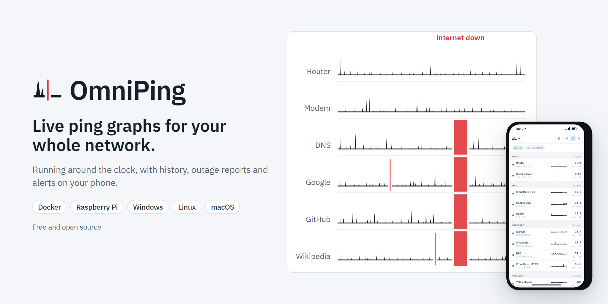
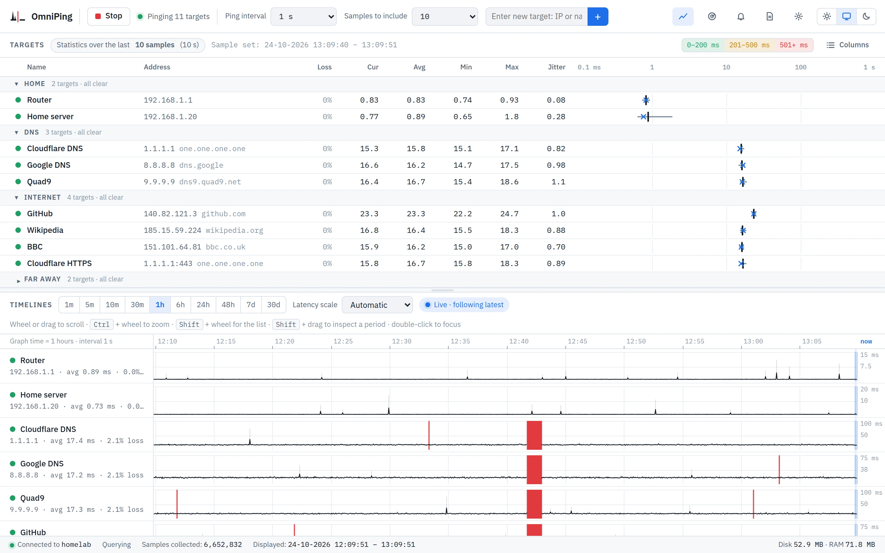

<picture>
  <source media="(prefers-color-scheme: dark)" srcset="https://github.com/sausje/OmniPing/raw/main/docs/images/banner-dark.png">
  
</picture>

<p align="center">
  <a href="https://github.com/sausje/OmniPing/releases/latest"></a>
  <a href="https://github.com/sausje/OmniPing/actions/workflows/ci.yml"></a>
  <a href="LICENSE"></a>
</p>

OmniPing pings your router, DNS servers and other hosts side by side, graphs the results live and keeps every one of them. When your connection drops, you can see where it broke, you get a notification, and afterwards you have a report of every outage to send to your internet provider.

It runs in Docker on a Raspberry Pi, NAS or server, as a service on Linux, or in the background on Windows. The web page works in any browser on your network, phones included.

<picture>
  <source media="(prefers-color-scheme: dark)" srcset="https://github.com/sausje/OmniPing/raw/main/docs/images/monitor-dark.webp">
  
</picture>

## Features

- Live timelines of latency and lost pings for every host, on one shared time axis. Scroll back, zoom, or select a period to look at it closely.
- Every ping is kept on disk, with one-minute summaries for the long term. Each host has a history page from 15 minutes to 30 days, with statistics and CSV export.
- Alert rules for packet loss, latency, no reply or a changed address, for one host, a group or everything. An outage rule treats your internet hosts as one, so a dropped connection sends one message instead of one per host.
- Notifications through ntfy, Telegram, Discord, Pushover, Gotify, email, webhooks, scripts and Windows notifications, retried for up to six hours while the internet is down. An optional weekly summary.
- Reports for any period: uptime, packet loss, every outage with its start and length, the outages that hit every host at once, and the hours when problems come back. Print them, save them as PDF or export them as CSV.
- TCP connect times for hosts that ignore pings, real DNS lookups for DNS servers, and a traceroute when the internet goes down.
- Automatic groups, expected-off hours, network scans, MultiPing `.lst` and `.mpl` import, a phone layout, light and dark themes, an optional password, and Prometheus metrics.
- One small Go program with the page built in. No database, no account, no telemetry.

## Install

### Docker

```yaml
services:
  omniping:
    image: ghcr.io/sausje/omniping:latest
    container_name: omniping
    restart: unless-stopped
    network_mode: host
    cap_add:
      - NET_RAW
    environment:
      TZ: Europe/London
    volumes:
      - omniping-data:/data

volumes:
  omniping-data:
```

Save it as `docker-compose.yml` and run `docker compose up -d`, or paste it into Portainer as a stack. Then open `http://<server>:8080`. Images are available for amd64, arm64 and armv7, so any Raspberry Pi from the 3 onwards works. See [Docker](docs/docker.md) for updates, bridge networking and permissions.

### Windows

Download `OmniPing-<version>-windows-setup.exe` from the [latest release](https://github.com/sausje/OmniPing/releases/latest) and run it; it needs no administrator rights. OmniPing then runs in the background with its icon next to the clock, and opens its page in your browser. There's also a portable zip. See [Windows](docs/windows.md).

### Linux

On Debian, Ubuntu or Raspberry Pi OS:

```bash
curl -fsSLO https://github.com/sausje/OmniPing/releases/latest/download/omniping_amd64.deb
sudo apt install ./omniping_amd64.deb
```

Use `omniping_arm64.deb` on a 64-bit Raspberry Pi and `omniping_armhf.deb` on 32-bit Raspberry Pi OS. For Fedora and other RPM-based systems, there are `.rpm` packages. The package installs a service that starts right away and at every boot; open `http://<computer>:8080`. See [Linux](docs/linux.md).

### macOS

Download `omniping-<version>-darwin-arm64` (Apple silicon) or `omniping-<version>-darwin-amd64` (Intel) from the [latest release](https://github.com/sausje/OmniPing/releases/latest) and start it in Terminal. See [macOS](docs/macos.md).

## Configuration

Targets, alert rules, notifications, ping interval, timeout and how long history is kept are all set in the page. A few things are set when OmniPing starts:

| Variable | Default | |
|---|---|---|
| `TZ` | system | Time zone for alerts, logs and reports, like `Europe/London` |
| `OMNIPING_PORT` | `8080` | Port of the web page |
| `OMNIPING_ADDR` | `:8080` | Full listen address, like `192.168.1.20:8080` |
| `OMNIPING_DATA` | `data` | Folder for settings and history (`/data` in Docker) |
| `OMNIPING_PASSWORD` | none | Password for the page and the API; wins over the one set in the page |
| `OMNIPING_ALLOW_SCRIPTS` | off | `true` allows the "Run a script" alert channel |
| `PUID`, `PGID` | `1000` | Docker only: the user and group OmniPing runs as |

## Documentation

- Installing: [Docker](docs/docker.md), [Windows](docs/windows.md), [Linux](docs/linux.md), [macOS](docs/macos.md)
- [Targets](docs/targets.md): ping, TCP and DNS checks, groups, expected-off hours
- [Alerts and notifications](docs/alerts.md): rules, outage rules, ntfy and other channels, the weekly summary
- [Data and backups](docs/data.md): where everything is kept, disk use, backups
- [Security](docs/security.md): the password, and what to know before exposing OmniPing
- [Prometheus and Grafana](docs/prometheus.md)
- [On your phone](docs/phone.md)
- [Privacy](docs/privacy.md): what OmniPing sends where
- [Code signing policy](docs/code-signing.md)

## Contributing

Bug reports, ideas and pull requests are welcome; see [CONTRIBUTING.md](CONTRIBUTING.md). Please report security problems privately, as described in [SECURITY.md](SECURITY.md).

## License

[MIT](LICENSE)

---

<sub>Built with Claude Code.</sub>
